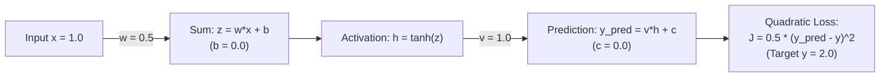

# Backpropagation & Numerical Gradient Verification (Task F)

## 1. Mathematical Problem & Network Architecture

This module implements a single-sample regression neural network to evaluate manual backpropagation using the multivariate chain rule and verify analytical derivatives against central finite differences.

### 1.1 Architecture Diagram

### 1.2 Mathematical Specifications
- **Input:** $x = 1.0$
- **Target:** $y = 2.0$
- **Hidden Layer:**
  $$z = w \cdot x + b$$
  $$h = \tanh(z) = \frac{e^z - e^{-z}}{e^z + e^{-z}}$$
- **Output Layer:**
  $$y_{\text{pred}} = v \cdot h + c$$
- **Loss Function:**
  $$J = \frac{1}{2}(y_{\text{pred}} - y)^2$$
- **Initial Parameter Vector:**
  $$\mathbf{\theta}_0 = [w_0, b_0, v_0, c_0]^T = [0.5, 0.0, 1.0, 0.0]^T$$
- **Learning Rate:** $\eta = 0.1$

---

## 2. Forward Propagation (Initial Step)

At step $t = 0$ with initial parameters:
1. **Pre-activation:**
   $$z = w_0 \cdot x + b_0 = 0.5 \cdot 1.0 + 0.0 = 0.5$$
2. **Hidden Activation:**
   $$h = \tanh(0.5) \approx 0.4621171572600098$$
3. **Prediction:**
   $$y_{\text{pred}} = v_0 \cdot h + c_0 = 1.0 \cdot 0.462117157260 + 0.0 = 0.462117157260$$
4. **Prediction Error:**
   $$e = y_{\text{pred}} - y = 0.462117157260 - 2.0 = -1.537882842740$$
5. **Initial Quadratic Loss:**
   $$J_0 = \frac{1}{2}(-1.537882842740)^2 \approx 1.182541818997$$

---

## 3. Manual Chain-Rule Backpropagation

The gradient vector $\nabla_{\mathbf{\theta}} J = \left[\frac{\partial J}{\partial w}, \frac{\partial J}{\partial b}, \frac{\partial J}{\partial v}, \frac{\partial J}{\partial c}\right]^T$ is derived analytically using the chain rule.

### 3.1 Output Layer Gradients
The loss sensitivity with respect to the network prediction is:
$$\delta_{\text{out}} = \frac{\partial J}{\partial y_{\text{pred}}} = y_{\text{pred}} - y$$

For output bias $c$:
$$\frac{\partial J}{\partial c} = \frac{\partial J}{\partial y_{\text{pred}}} \frac{\partial y_{\text{pred}}}{\partial c} = \delta_{\text{out}} \cdot 1 = -1.537882842740$$

For output weight $v$:
$$\frac{\partial J}{\partial v} = \frac{\partial J}{\partial y_{\text{pred}}} \frac{\partial y_{\text{pred}}}{\partial v} = \delta_{\text{out}} \cdot h = -1.537882842740 \cdot 0.462117157260 = -0.710682047486$$

### 3.2 Hidden Layer Gradients
Using the derivative of hyperbolic tangent $\frac{d}{dz}\tanh(z) = 1 - \tanh^2(z) = 1 - h^2$:
$$\delta_{\text{hidden}} = \frac{\partial J}{\partial z} = \frac{\partial J}{\partial y_{\text{pred}}} \frac{\partial y_{\text{pred}}}{\partial h} \frac{dh}{dz} = \delta_{\text{out}} \cdot v \cdot (1 - h^2)$$

Substituting the initial values:
$$1 - h^2 = 1 - (0.462117157260)^2 \approx 0.786447732966$$
$$\delta_{\text{hidden}} = -1.537882842740 \cdot 1.0 \cdot 0.786447732966 = -1.209464475240$$

For hidden weight $w$:
$$\frac{\partial J}{\partial w} = \frac{\partial J}{\partial z} \frac{\partial z}{\partial w} = \delta_{\text{hidden}} \cdot x = -1.209464475240 \cdot 1.0 = -1.209464475240$$

For hidden bias $b$:
$$\frac{\partial J}{\partial b} = \frac{\partial J}{\partial z} \frac{\partial z}{\partial b} = \delta_{\text{hidden}} \cdot 1.0 = -1.209464475240$$

### 3.3 Simultaneous Parameter Updates
All four parameters are updated simultaneously using their original values:
$$\theta_{t+1} = \theta_t - \eta \frac{\partial J}{\partial \theta_t}$$

With learning rate $\eta = 0.1$:
- $w_1 = 0.5 - 0.1 \cdot (-1.209464475240) = 0.620946447524$
- $b_1 = 0.0 - 0.1 \cdot (-1.209464475240) = 0.120946447524$
- $v_1 = 1.0 - 0.1 \cdot (-0.710682047486) = 1.071068204749$
- $c_1 = 0.0 - 0.1 \cdot (-1.537882842740) = 0.153788284274$

---

## 4. Central Finite-Difference Numerical Verification

To guarantee correctness without automatic differentiation libraries, each analytical derivative is verified against a two-sided central difference approximation:
$$\text{grad}_{\text{numerical}}(\theta) = \frac{J(\theta + \epsilon) - J(\theta - \epsilon)}{2\epsilon}, \quad \epsilon = 1.0 \times 10^{-6}$$

### 4.1 Verification Comparison Table ($\epsilon = 1.0 \times 10^{-6}$, Tolerance $\le 1.0 \times 10^{-5}$)

| Parameter ($\theta$) | Analytical Gradient ($\frac{\partial J}{\partial \theta}$) | Central Difference Gradient ($J_{\text{num}}'$) | Absolute Error ($|\Delta|$) | Verification Status |
| :---: | :---: | :---: | :---: | :---: |
| **$w$** | `-1.209464475240` | `-1.209464475349` | $1.09 \times 10^{-10}$ | **PASSED** ($\le 10^{-5}$) |
| **$b$** | `-1.209464475240` | `-1.209464475349` | $1.09 \times 10^{-10}$ | **PASSED** ($\le 10^{-5}$) |
| **$v$** | `-0.710682047486` | `-0.710682047433` | $5.31 \times 10^{-11}$ | **PASSED** ($\le 10^{-5}$) |
| **$c$** | `-1.537882842740` | `-1.537882842628` | $1.12 \times 10^{-10}$ | **PASSED** ($\le 10^{-5}$) |

The maximum observed difference across all parameters is $\approx 1.12 \times 10^{-10}$, well within the required $1.0 \times 10^{-5}$ threshold.

---

## 5. 100-Step Training Experiment & Results

### 5.1 Training Protocol & Step Definition
- **Step Indexing Definition:** The training history records exactly 100 sequential steps indexed from **Step 1** to **Step 100**.
- At each step $s \in [1, 100]$:
  1. Prediction $y_{\text{pred}}$ and loss $J$ are computed using parameters $\mathbf{\theta}_s$.
  2. Gradients $\nabla J$ are evaluated at $\mathbf{\theta}_s$.
  3. Step record $(s, J, y_{\text{pred}}, \mathbf{\theta}_s, \nabla J)$ is recorded.
  4. Parameters are updated simultaneously: $\mathbf{\theta}_{s+1} = \mathbf{\theta}_s - \eta \nabla J$.
- The complete history is exported to `results/backprop/loss_history.csv`.

### 5.2 Training Progression Table

| Step | Loss ($J$) | Prediction ($y_{\text{pred}}$) | Weight ($w$) | Bias ($b$) | Weight ($v$) | Bias ($c$) |
| :---: | :---: | :---: | :---: | :---: | :---: | :---: |
| **1** | **1.182541818997** | 0.462117 | 0.500000 | 0.000000 | 1.000000 | 0.000000 |
| **2** | **0.685773765045** | 0.828869 | 0.620946 | 0.120946 | 1.071068 | 0.153788 |
| **5** | **0.161288420954** | 1.432042 | 0.784680 | 0.284680 | 1.264554 | 0.434030 |
| **10** | **0.016125402355** | 1.820415 | 0.869038 | 0.369038 | 1.417757 | 0.622543 |
| **25** | **0.000021389851** | 1.993458 | 0.902644 | 0.402644 | 1.490518 | 0.707758 |
| **50** | **0.000000000007** | 1.999996 | 0.903728 | 0.403728 | 1.492946 | 0.710641 |
| **100** | **0.000000000000** | **2.000000** | **0.903729** | **0.403729** | **1.492948** | **0.710644** |

### 5.3 Convergence Summary
- **Initial Loss (Step 1):** `1.182541818997` ($y_{\text{pred}} = 0.462117$).
- **Final Loss (Step 100):** `< 1.0e-12` ($y_{\text{pred}} = 1.999999999768 \approx 2.000000$).
- **Total Loss Reduction:** Reduced to machine epsilon towards target $y = 2.0$.
- **Finite Check:** All loss, prediction, and parameter values remain strictly finite throughout the entire run.

---

## 6. Debugging Insight: In-Place Parameter Mutation vs. Simultaneous Updates

A subtle implementation pitfall in manual backpropagation is **premature in-place parameter mutation**:
- If an algorithm updates $w$ in place (`params.w -= lr * dw`) *before* computing the gradient for bias $b$, weight $v$, or bias $c$, the forward activation $h = \tanh(w \cdot x + b)$ is evaluated with the *new* $w$ rather than the current parameter state.
- Because $v$ and $c$ gradients depend directly on $h$, updating $w$ prematurely alters $\frac{\partial J}{\partial v}$ and $\frac{\partial J}{\partial c}$.
- In `test_original_parameters_enforcement()`, mutating $w$ before computing remaining gradients was shown to produce discrepancies $> 10^{-4}$ in the remaining derivatives.
- **Resolution:** Gradients must be computed as a pure function of the immutable input parameter state `const NetworkParameters&`, and parameter updates applied strictly as a vector operation $\mathbf{\theta}_{t+1} = \mathbf{\theta}_t - \eta \nabla J$.
