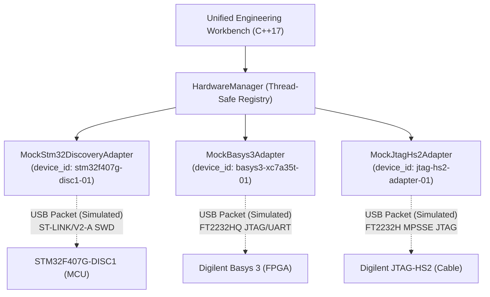

# Hardware Integration & Communication Protocols (Task E)

## 1. System Architecture Overview

The **Unified Engineering Workbench** hardware integration subsystem provides a modular, extensible, and thread-safe interface for managing target engineering devices. The architecture decouples high-level desktop operations (telemetry monitoring, firmware/bitstream flashing, register inspection) from device-specific transport protocols.

In Stage 7, mock implementations are provided for three target devices:
1. **STM32F407G-DISC1** (STMicroelectronics ARM Cortex-M4 Microcontroller Discovery Board).
2. **Digilent Basys 3** (Xilinx Artix-7 XC7A35T FPGA Development Board).
3. **Digilent JTAG-HS2** (High-Speed USB-JTAG Programming Cable).

> [!IMPORTANT]
> **SIMULATION NOTICE:**
> All adapters in Stage 7 are **SIMULATED** mock implementations. No physical hardware connection is made or claimed. All device descriptors and telemetry packets explicitly declare `is_simulated = true`.

---

## 2. Block Diagram: Host Architecture & Device Interfaces

### 2.1 Logical Software Architecture


### 2.2 Physical System Topology & Signal Interfaces
```text
+----------------------------------------------------------------------------------------------------+
|                               HOST WORKSTATION (Windows 11 x64)                                    |
|  +----------------------------------------------------------------------------------------------+  |
|  |                            Unified Engineering Workbench (C++17)                             |  |
|  |                                  [HardwareManager Registry]                                  |  |
|  +-------------------+------------------------------+---------------------------+---------------+  |
+----------------------|------------------------------|---------------------------|------------------+
                       | USB 2.0 (5V VBUS, D+, D-, GND)|                           |
                       v                              v                           v
             [USB Mini-B Cable]              [Micro-USB Cable]             [USB Type-A Connector]
                       |                              |                           |
                       v                              v                           v
      +---------------------------------+  +-----------------------+  +-------------------------------+
      |        STM32F407G-DISC1         |  |    Digilent Basys 3   |  |       Digilent JTAG-HS2       |
      | +-----------------------------+ |  | +-------------------+ |  | +---------------------------+ |
      | | Onboard ST-LINK/V2-A (MCU)  | |  | | Onboard FT2232HQ  | |  | | FTDI FT2232H High-Speed USB | |
      | | - SWCLK, SWDIO, NRST, SWO   | |  | | Channel A: JTAG   | |  | | MPSSE Engine (JTAG Master)  | |
      | +--------------+--------------+ |  | | Channel B: UART   | |  | +-------------+---------------+ |
      |                | SWD Bus        |  | +---------+---------+ |  +--------------|----------------+
      |                v                |  |           |           |                 |
      | +-----------------------------+ |  |           v           |                 v
      | | STM32F407VGT6 Target MCU    | |  | +-------------------+ |  [14-Pin 2x7 2mm Ribbon Connector]
      | | - VDD: 3.3V, VCORE: 1.2V    | |  | | Artix-7 XC7A35T   | |  | - VREF (1.8V-5.0V Reference)  |
      | | - Internal Temp Sensor      | |  | | - VCCINT: 1.0V    | |  | - TCK, TMS, TDI, TDO, GND     |
      | +-----------------------------+ |  | | - VCCAUX: 1.8V    | |  +-------------------------------+
      |                                 |  | | - VCCO:   3.3V    | |
      |                                 |  | | - XADC Die Temp   | |
      |                                 |  | +---------+---------+ |
      |                                 |  |           ^           |
      |                                 |  |           |           |
      |                                 |  |   [6-Pin J1 Header]   |
      +---------------------------------+  +-----------------------+
```

---

## 3. Interface and Pin-Voltage Comparison Table

| Attribute / Specification | STM32F407G-DISC1 | Digilent Basys 3 | Digilent JTAG-HS2 |
| :--- | :--- | :--- | :--- |
| **Device Category** | Microcontroller Discovery Board | FPGA Development Board | Dedicated High-Speed JTAG Cable |
| **Primary Processor / Silicon** | STM32F407VGT6 (ARM Cortex-M4F) | Xilinx Artix-7 XC7A35T-1CPG236C | FTDI FT2232H USB-Serial/FIFO |
| **Host Connection Interface** | USB 2.0 Full-Speed Mini-B | USB 2.0 Hi-Speed Micro-USB | USB 2.0 Hi-Speed Type-A |
| **Host Physical Signaling** | USB D+ / D− (NRZI Packets) | USB D+ / D− (NRZI Packets) | USB D+ / D− (NRZI Packets) |
| **Onboard Bridge Controller** | STM32F103CBT6 (ST-LINK/V2-A) | FTDI FT2232HQ Dual USB-UART/FIFO | Integrated FTDI FT2232H |
| **Target Debug Protocol** | **SWD** (Serial Wire Debug) | **JTAG** (IEEE 1149.1) & UART | **JTAG** (IEEE 1149.1) |
| **Board Physical Debug Connector** | USB Mini-B (No 20-pin JTAG header) | 6-pin unpopulated JTAG footprint (J1) | 14-pin 2×7 2 mm keyed female ribbon |
| **Debug Signals Present** | SWCLK, SWDIO, NRST, SWO | TCK, TMS, TDI, TDO, GND, VDD | TCK, TMS, TDI, TDO, GND, **VREF** |
| **Nominal Logic Voltage** | 3.3 V | 3.3 V (VCCO Banks 14/15/34) | 1.8 V to 5.0 V (Sensed via VREF) |
| **Internal Core Voltage** | 1.2 V (Internal LDO) | 1.0 V (Internal switching regulator) | 3.3 V (Internal 5V-to-3.3V LDO) |
| **Auxiliary Voltage Rail** | N/A | 1.8 V (VCCAUX) | N/A |
| **VREF Pin Behavior** | Board 3.3V Power Out | Sensed Target Voltage (at J1 pin 1) | **Level-Reference Input (NOT Power)** |
| **Secondary Telemetry Channel** | Virtual COM Port (VCP) via ST-LINK | Channel B of FT2232HQ (USB-UART) | **None** (Pure JTAG adapter) |

---

## 4. Power, Voltage Domains, and Ground Considerations

### 4.1 USB Bus Power vs. Target Power
- **Host USB 5.0 V (VBUS):** Supplies input power to the onboard regulators of each board.
- **STM32F407G-DISC1:** Onboard 5V-to-3.3V LDO supplies the 3.3V VDD rail to the STM32F407 MCU and the ST-LINK MCU. Internal core logic operates at 1.2V via the MCU's internal voltage regulator.
- **Basys 3:** Step-down switching regulators generate:
  - **1.0 V** (VCCINT: Artix-7 internal logic and block RAM).
  - **1.8 V** (VCCAUX: Configurable clock and I/O buffer drivers).
  - **3.3 V** (VCCO: Peripheral headers and Pmod banks).
- **Digilent JTAG-HS2:** Powered entirely from host USB 5V VBUS (~30 mA idle, up to 100 mA active).

### 4.2 Target VREF Level Reference Behavior
> [!CAUTION]
> **VREF IS A VOLTAGE SENSE REFERENCE, NOT A POWER SUPPLY:**
> The VREF pin on the Digilent JTAG-HS2 14-pin ribbon connector is an **input** pin connected to internal bidirectional level shifters. It requires between 1.8 V and 5.0 V from the target system to sense the target I/O voltage domain. **Never attempt to power a target board from the JTAG-HS2 VREF pin.**

### 4.3 Ground Loops and Common Reference
- All devices connected to the same host workstation share a common digital ground via the host USB shield and ground pins.
- If target boards are powered from external benchtop power supplies rather than USB, a common ground connection must be established between the target ground and the adapter ground pin to prevent floating voltage references.

---

## 5. Host Communication & Signal Layering

### 5.1 USB D+/D− Physical Layer vs. Protocols
- **USB D+ and D− lines carry differential USB signaling (NRZI encoded packets at 12 Mbps Full-Speed or 480 Mbps Hi-Speed).**
- USB D+/D− pins **do not** directly carry raw UART TX/RX, raw SWD, or raw JTAG clock/data signals.
- The onboard bridge chip (ST-LINK or FTDI) parses incoming USB packets and translates USB vendor requests into hardware-timed SWD or JTAG waveform shifts.

---

## 6. JTAG Signal Ownership and Multi-Master Bus Contention

### 6.1 The Bus Contention Problem
On the Digilent Basys 3, the onboard FTDI FT2232HQ Channel A is directly wired to the Artix-7 FPGA JTAG pins (TCK, TMS, TDI, TDO).
The unpopulated 6-pin J1 header is wired in parallel to these exact same JTAG lines.

```text
                  +--------------------------------+
                  |  Onboard FT2232HQ (Master 1)   |
                  +---------------+----------------+
                                  |
                                  | JTAG Bus (TCK, TMS, TDI, TDO)
+-------------------------+       |       +-------------------------+
| JTAG-HS2 Cable (Master 2)|-----[J1]---->| Artix-7 FPGA (Target)   |
+-------------------------+               +-------------------------+
```

### 6.2 Bus Contention Mitigation Rule
If an external Digilent JTAG-HS2 cable is connected to the Basys 3 J1 header:
1. **Never attempt to drive JTAG lines simultaneously from both the onboard FT2232HQ and the external JTAG-HS2.**
2. Simultaneous driving causes electrical contention (short circuits between totem-pole drivers), resulting in signal degradation, excessive current draw, or damaged buffer transistors.
3. The onboard FT2232HQ must be held in reset or its JTAG output buffers must be tri-stated before the JTAG-HS2 drives the J1 header.

---

## 7. Verified Hardware Facts vs. Conceptual Assumptions

| Component / Subsystem | Manufacturer-Verified Hardware Fact | Invalid Conceptual Assumption |
| :--- | :--- | :--- |
| **STM32F407G-DISC1 Debug** | Integrated ST-LINK/V2-A uses **SWD** (SWCLK/SWDIO). Has Mini-B connector. | Assuming a standard 20-pin ARM JTAG connector is present. |
| **Basys 3 JTAG Interface** | Primary JTAG is onboard FT2232HQ via Micro-USB. Auxiliary is **6-pin J1 header**. | Assuming Basys 3 uses a 14-pin ribbon connector. |
| **JTAG-HS2 Connector** | Uses a **14-pin 2×7 2 mm ribbon connector** keyed with pin 1 indicator. | Assuming JTAG-HS2 plugs directly into standard 0.1" (2.54 mm) headers without adapter. |
| **JTAG-HS2 VREF Pin** | Senses target voltage level (1.8 V – 5.0 V) for internal level translation. | Assuming VREF supplies 3.3V or 5V power to run the target board. |
| **JTAG Bus Topology** | Each board/cable is an independent USB device with its own debug endpoint. | Assuming all devices share a physical JTAG daisy chain (TDO -> TDI). |
| **Telemetry Capabilities** | JTAG-HS2 has no UART data channel. STM32 and Basys 3 provide Virtual COM UART. | Assuming all three devices provide identical telemetry streams and UART data. |

---

## 8. Safe Physical Integration Plan

1. **Inspection:** Verify that JTAG-HS2 ribbon cable connector pinout matches target header orientation (Pin 1 indicator aligned).
2. **Voltage Matching:** Verify target logic rail is between 1.8 V and 5.0 V before connecting JTAG-HS2.
3. **Power Sequencing:** Power target board first; connect USB host second.
4. **Disconnection:** Disconnect debugger in software before removing physical USB or ribbon cables.
5. **No Hot-Plugging JTAG Headers:** Power down target board before mating/unmating 6-pin or 14-pin ribbon headers.

---

## 9. Hardware Limitations
1. **Simulation Boundaries:** Current adapters provide deterministic simulated telemetry and state transitions. Timing measurements reflect software execution rather than USB bus latency.
2. **Daisy Chaining:** Dynamic daisy chaining of multiple TAPs on a shared boundary-scan chain is not supported; each device is treated as an independent USB peripheral.
3. **Cable Clock Limits:** Real JTAG-HS2 supports up to 30 MHz TCK; actual throughput depends on board trace lengths and signal integrity.
